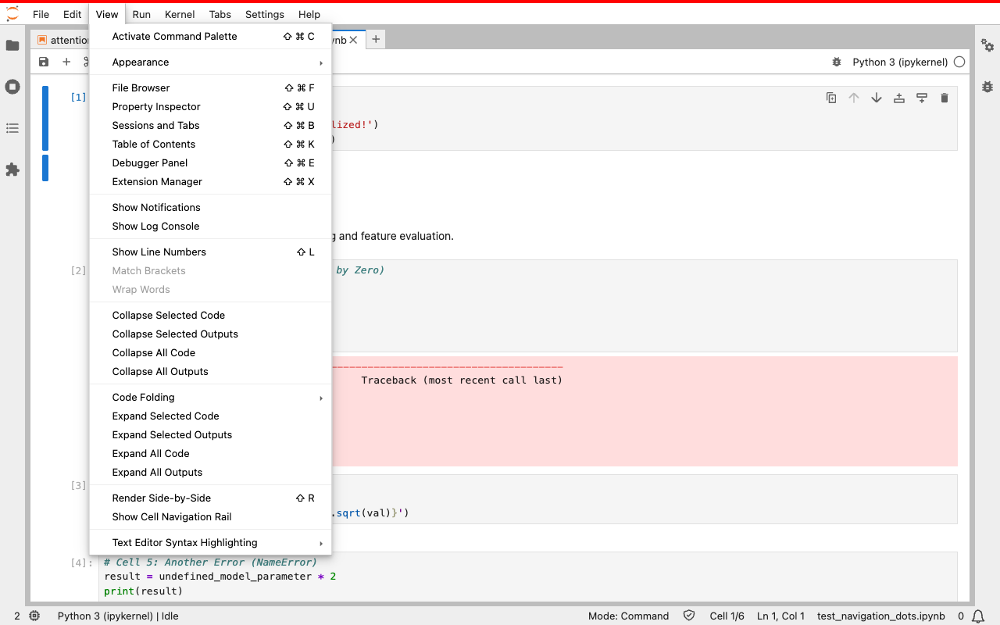
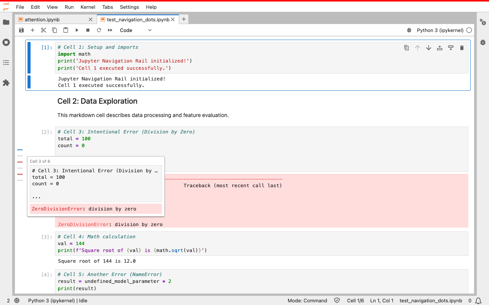
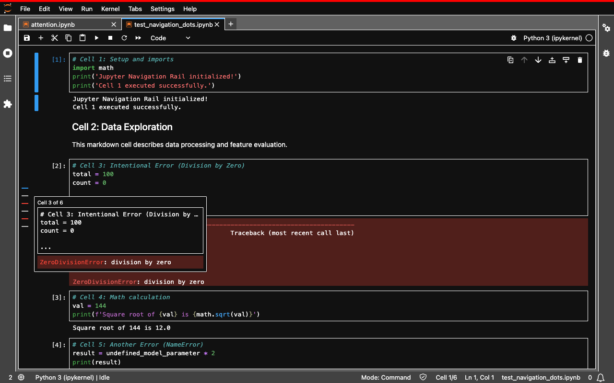

# jupyterlab-cell-navigation-rail

[](https://github.com/saitejagirada/jupyterlab-cell-navigation-rail/actions/workflows/build.yml)

An opt-in, compact left-margin **Cell Navigation Rail** for **JupyterLab 4** and **Jupyter Notebook 7**.

Each cell in the notebook is represented by a uniform horizontal bar in a fixed-height rail on the left edge, inspired by margin bookmark indicators in ePub readers and compact overview rails. Hovering a bar previews the cell (code, Markdown, or error traceback) with native Jupyter typography, and clicking jumps straight to that cell.

## Motivation

Navigating long notebooks to revisit a cell or spot failed runs usually means scrolling through the document or opening a side panel. Existing tools solve adjacent problems:

- **Table of Contents** requires Markdown headings and opens a sidebar.
- **Show Minimap** (`View -> Appearance -> Show Minimap`) shows a scrollable strip of scaled cell source previews along the right scrollbar.

**Cell Navigation Rail** focuses on a minimal, fixed-height glanceable margin rail:

- **Opt-in by default (`default: false`):** Disabled until enabled in the **View** menu or Settings.
- **Uniform horizontal bars (`14px x 2px`):** Neutral for idle cells, brand blue for the active cell, pulsing warning accent while running, and red when a cell output contains an error.
- **Hover preview tooltips:** Previews cell code, Markdown text, or error messages using native JupyterLab tokens (`--jp-cell-editor-*`, `--jp-content-font-*`, `--jp-rendermime-error-background`).
- **One-click jump:** Selecting any bar scrolls to and focuses that cell.
- **Works in JupyterLab 4 and Jupyter Notebook 7.**

## Screenshots

### Light Theme — View Menu & Error Preview





### Dark Theme & Native Token Adaptation



### Comparison with Built-in Minimap

Cell Navigation Rail (compact fixed-height bars + hover preview on the left) alongside JupyterLab's scrollable code Minimap (on the right):


### Jupyter Notebook 7


## Requirements

- JupyterLab >= 4.0.0 (or Jupyter Notebook >= 7.0.0)

## Install

Install directly from GitHub:

```bash
pip install "git+https://github.com/saitejagirada/jupyterlab-cell-navigation-rail.git"
```

## Usage

Toggle the rail from:

- **View -> Show Cell Navigation Rail**
- Command Palette: **Show Cell Navigation Rail**
- Settings Editor: **Cell Navigation Rail -> Show cell navigation rail**

## Development install

```bash
git clone https://github.com/saitejagirada/jupyterlab-cell-navigation-rail.git
cd jupyterlab-cell-navigation-rail

pip install -e .
jupyter labextension develop . --overwrite
```

Rebuild TypeScript and run checks:

```bash
jlpm
jlpm run lint:check
jlpm run test
jlpm build
```

## Uninstall

```bash
pip uninstall jupyterlab_cell_navigation_rail
```
